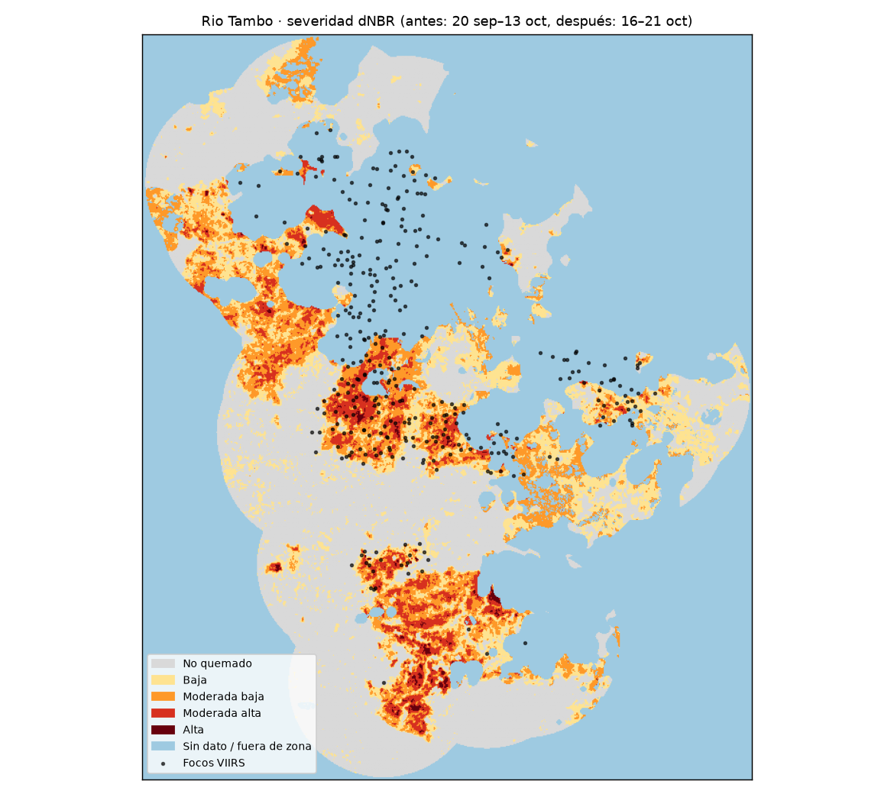

# Incendios en el Perú: ¿cuánto se quemó y qué casas quedaron cerca?

Tarea de raster · Ciencia de Datos con Python, Diplomado QLAB · 21 de octubre de 2026

**Dashboard:** https://ximenapize.github.io/python-qlab/tarea_raster/docs/

## La pregunta

En los cinco distritos con más fuego de la semana del 14 al 21 de octubre de 2026:

1. ¿Cuántas hectáreas se quemaron?
2. ¿Qué tipo de cobertura se quemó: bosque, pastizal o cultivo? (reto C)
3. ¿Cuántas casas quedaron cerca del fuego y qué vegetación las rodea?

## Los datos y sus fechas

| Dato | Fuente | Fecha | Tipo |
|---|---|---|---|
| Focos de calor | NASA FIRMS, VIIRS 375 m (S-NPP, NOAA-20, NOAA-21), CSV «South America 7d» | 14–21 oct 2026, descargado el 21 oct | Puntos |
| Imágenes | Sentinel-2 L2A, Microsoft Planetary Computer | 20 sep – 21 oct 2026 | Raster 20 m |
| Cobertura del suelo | ESA WorldCover, Planetary Computer | 2021 | Raster 10 m |
| Relieve (solo para el mapa) | Copernicus DEM GLO-90, Planetary Computer | — | Raster 90 m |
| Edificaciones | Google + Microsoft Open Buildings (VIDA, Source Cooperative) | Google v3, 2023 | Polígonos |
| Límites distritales | INEI vía [juaneladio/peru-geojson](https://github.com/juaneladio/peru-geojson) | versión simplificada | Polígonos |

Ningún dato pide clave ni pago.

## El método

1. **Elegir los distritos** (`01_ranking_distritos.py`). Uní los focos de los tres satélites, quité los de confianza baja y los crucé con los distritos. Ordené por **huella**: cada píxel de 375 m con fuego cuenta una sola vez, aunque lo vean varios satélites. Los cinco primeros son todos de selva: Río Tambo (Junín), Nueva Requena, Masisea, Raymondi y Tahuania (Ucayali).
2. **Zona del fuego** (`02_escenas.py`). Los focos del distrito con un buffer de 2 km. Antes de calcular revisé las fechas de Sentinel-2 y el % de nubes en esa zona. Ninguna fecha sola servía para los cinco distritos, así que usé compuestos.
3. **dNBR** (`03_dnbr.py`).
   - Antes: la mediana de los píxeles sin nube del 20 de septiembre al 13 de octubre.
   - Después: el último píxel sin nube del 16 al 21 de octubre.
   - NBR = (B8A − B12) / (B8A + B12), con el offset de −1000 de Sentinel-2 L2A.
   - Las nubes, sombras y el agua se enmascaran con la capa SCL.
4. **Sembrado con focos** (`05_sembrado.py`). Cuenta como quemado un píxel con dNBR ≥ 0,27 **y** a 1 km o menos de un foco de la semana. Esto deja fuera quemas anteriores y cambios que no son fuego. Las clases de severidad siguen a Key y Benson (2006).
5. **Edificaciones** (`06_buildings.py`). Se leen del GeoParquet remoto del Perú (2,7 GB) bajando solo la caja de cada zona.
6. **Cobertura y riesgo** (`07_cobertura_indice.py`).
   - Cobertura: cruce de lo quemado con WorldCover.
   - Riesgo por casa, según la distancia a lo quemado: **muy alto** < 100 m · **alto** 100–500 m · **medio** 500 m–1 km · **bajo** > 1 km.
   - Para cada casa también se guarda la cobertura dominante y el % de vegetación en un radio de 100 m.
   - Primero probé un índice que promediaba cercanía y vegetación. En la selva casi todo es "bosque", así que el 80 % de las casas salía en riesgo alto y el índice no distinguía nada. Por eso la vegetación quedó como dato aparte.
7. **Exportar y dashboard** (`08_exportar.py`, `09_base_mapa.py`, `docs/index.html`, con deck.gl).

## Hallazgos

| Distrito | Quemado (ha) | Sin dato (nubes/humo) | Edificaciones en la zona | Casas a < 100 m | Casas a < 500 m |
|---|---:|---:|---:|---:|---:|
| Río Tambo | 1 927 | 33 % | 11 610 | **780** | 5 005 |
| Nueva Requena | 2 092 | 1 % | 2 024 | 85 | 888 |
| Masisea | 1 351 | 26 % | 4 435 | 398 | 1 770 |
| Raymondi | 942 | 41 % | 4 564 | 375 | 1 906 |
| Tahuania | 649 | 35 % | 1 940 | 144 | 999 |
| **Total** | **6 961** | | **24 573** | **1 782** | **10 568** |

1. **Se quemaron 6 961 ha en una semana, y el 93 % era bosque** (6 453 ha). El pastizal suma 462 ha y el cultivo apenas 11 ha. El fuego avanza sobre el bosque, no sobre chacras ya abiertas, aunque WorldCover es de 2021 y no ve chacras más recientes.
2. **10 568 casas (43 % de las de la zona) están a menos de 500 m de lo quemado, y 217 quedaron dentro.** Río Tambo concentra el 44 % de las casas en riesgo muy alto: 780 de 1 782. Allí 8 de cada 10 de esas casas están rodeadas de bosque.
3. **Más área quemada no significa más gente en riesgo.** Nueva Requena es el distrito con más hectáreas quemadas (2 092), pero tiene solo 85 casas a menos de 100 m. Río Tambo quema menos (1 927 ha) y tiene 9 veces más casas pegadas al fuego.

Además, la cifra depende del método. Con el mismo dNBR sin el filtro de focos salen 14 629 ha, y la huella de los focos VIIRS suma 14 667 ha. El sembrado con focos reduce la cifra a menos de la mitad.

## Mapa



Severidad del incendio principal de Río Tambo. En celeste las zonas sin dato: nubes, humo o fuera de la zona analizada. El mapa interactivo de los cinco distritos está en el [dashboard](https://ximenapize.github.io/python-qlab/tarea_raster/docs/).

## Limitaciones

- **Un foco de calor no es un incendio.** En Ucayali los focos forman decenas de grupos pequeños dispersos (Masisea: 70 grupos), un patrón típico de quemas agrícolas.
- **Las nubes y el humo esconden el fuego.** La capa SCL de Sentinel-2 marca el humo como nube. En Río Tambo falta un tercio de la zona, justo donde hay más focos, así que el área quemada real puede ser mayor.
- **Open Buildings** no ve casas bajo árboles, no dice de qué material son y es de 2023.
- **WorldCover es de 2021.** Una chacra abierta después aparece como "bosque".
- **Los límites distritales están simplificados.** Un foco pegado al borde puede caer en el distrito vecino.
- El riesgo mide **exposición por distancia**, no la probabilidad de daño.

## Cómo reproducirlo

```bash
cd tarea_raster
python -m venv .venv && .venv/bin/pip install -r requirements.txt
mkdir -p data/raw && cd data/raw
for u in suomi-npp-viirs-c2/csv/SUOMI_VIIRS_C2_South_America_7d.csv \
         noaa-20-viirs-c2/csv/J1_VIIRS_C2_South_America_7d.csv \
         noaa-21-viirs-c2/csv/J2_VIIRS_C2_South_America_7d.csv; do
  curl -LO "https://firms.modaps.eosdis.nasa.gov/data/active_fire/$u"
done
curl -L -o peru_distrital.geojson https://raw.githubusercontent.com/juaneladio/peru-geojson/master/peru_distrital_simple.geojson
cd ../..
.venv/bin/python scripts/01_ranking_distritos.py
.venv/bin/python scripts/02_escenas.py
for d in "RIO TAMBO" "NUEVA REQUENA" "MASISEA" "RAYMONDI" "TAHUANIA"; do
  .venv/bin/python scripts/03_dnbr.py "$d"
  .venv/bin/python scripts/05_sembrado.py "$d"
  .venv/bin/python scripts/06_buildings.py "$d"
  .venv/bin/python scripts/07_cobertura_indice.py "$d"
done
.venv/bin/python scripts/08_exportar.py && .venv/bin/python scripts/09_base_mapa.py
cd docs && python -m http.server   # abrir http://localhost:8000
```

El dNBR tarda unos 7 minutos por distrito en CPU. `04_mapa_dnbr.py` genera el mapa estático del README.

Trabajo de clase. No reemplaza los reportes del COEN, INDECI ni SERFOR.
